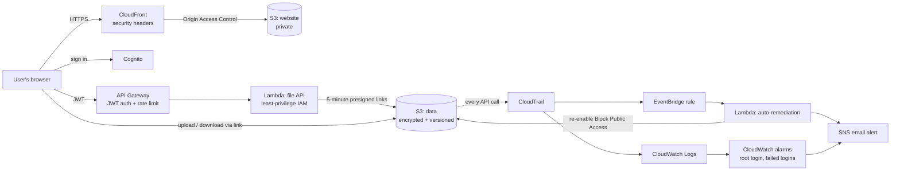

# Secure Cloud Storage on AWS 🛡️

A secure file-storage web app on AWS that **protects, monitors and repairs itself**. Users sign in, upload and download files through short-lived links, and see a live security dashboard. If anyone makes the storage public, by mistake or on purpose, an event-driven guardrail locks it again within seconds and emails an alert.

Everything is built as code with **Terraform** and runs inside the **AWS Free Tier**.

## Architecture



## AWS services used (14, plus 1 optional)

| Service | What it does here |
|---|---|
| **S3** | Encrypted, versioned, private buckets for files, the website and logs |
| **CloudFront** | Serves the website over HTTPS with strict security headers (CSP, HSTS, no framing) |
| **Cognito** | User sign-in; no public sign-up, admin-created accounts only |
| **API Gateway** | HTTP API that checks the user's login token on every request and rate-limits |
| **Lambda** | Two functions: the file API and the auto-remediation guardrail |
| **IAM** | Least-privilege roles for every component, plus a read-only security auditor role |
| **STS** | Temporary credentials when the CLI client assumes the app role |
| **CloudTrail** | Records every management API call, to S3 and CloudWatch Logs |
| **EventBridge** | Spots risky S3 changes in CloudTrail and triggers the guardrail |
| **SNS** | Emails security alerts |
| **CloudWatch** | Logs, metric filters, alarms and a security dashboard |
| **X-Ray** | Traces both Lambda functions |
| **IAM Access Analyzer** | Flags anything shared outside the account |
| **S3 Storage Lens** | Storage usage dashboard |
| **GuardDuty** (optional) | Threat detection; off by default because it is a 30-day trial |

## Security controls

**Data protection**
- S3 Block Public Access on every bucket, ACLs disabled
- Encryption at rest (SSE-S3) and HTTPS-only bucket policies
- Versioning with a 7-day undo window
- S3 server access logs for the data and website buckets

**Access control**
- Cognito login with a strong password policy; the API rejects requests without a valid token
- Each user can only reach their own folder (`users/<their-id>/`), enforced in code and by IAM
- The browser never holds AWS keys; uploads and downloads use presigned links that expire in 5 minutes
- File size limits are enforced by S3 itself through the presigned POST policy, not just by the browser
- File names are sanitised so nobody can escape their folder
- API rate limiting (10 requests/second, burst 20)

**Detection and response**
- CloudTrail with log file validation, sent to S3 and CloudWatch Logs
- Auto-remediation: weakening a bucket's public access settings triggers EventBridge, and a Lambda re-locks the bucket and emails an alert. It ignores its own changes (no loops), failed API calls, and buckets that are already safe.
- CloudWatch alarms (CIS benchmark style) for root account use, failed console logins and remediation errors
- The website shows a live security status panel and recent auto-fixes

**Secure development**
- Every push runs **tfsec** (infrastructure security scan) and **pytest** unit tests in GitHub Actions
- Every accepted tfsec finding has a written reason in the code (`#tfsec:ignore` comments), usually that the fix costs money outside the free tier

## Project structure

```
.
├── terraform/            # all infrastructure as code
│   ├── main.tf           # data + logging buckets
│   ├── website.tf        # site bucket, CloudFront, security headers
│   ├── auth.tf           # Cognito
│   ├── api.tf            # API Gateway + file API Lambda
│   ├── remediation.tf    # EventBridge + remediation Lambda
│   ├── monitoring.tf     # CloudTrail, alarms, dashboard, Access Analyzer, Storage Lens, GuardDuty
│   ├── alerts.tf         # SNS
│   ├── iam.tf            # app role + security auditor role
│   └── terraform.tfvars.example
├── lambda/
│   ├── api/api.py        # file API
│   └── remediator/remediate.py
├── frontend/             # the website (HTML, CSS, JS)
├── src/secure_client.py  # command-line client using STS AssumeRole
├── tests/                # unit tests with a mocked AWS (moto)
└── .github/workflows/    # tfsec + tests on every push
```

## Deploy

**You need:** Terraform, the AWS CLI configured with an IAM admin user (not root), and Python 3.

```bash
cd terraform
cp terraform.tfvars.example terraform.tfvars   # then edit: your email + a password
terraform init
terraform apply
```

The first deploy takes about 10 minutes, mostly CloudFront. Then:

1. **Confirm the SNS email.** AWS sends a "Subscription Confirmation" email; click the link or you won't get alerts.
2. Open `website_url` from the Terraform output and sign in with your username and password.

## Demo script

1. **Website:** sign in, upload a file, download it, and show the security status panel (all green).
2. **Least privilege:** in IAM, show that the API Lambda can only reach `users/*` in the data bucket.
3. **Attack and auto-fix:** in S3, turn off Block Public Access on the data bucket. Within about a minute the website panel shows a new auto-fix, the bucket is locked again, and an alert email arrives.
4. **Evidence:** CloudTrail Event history shows who made the change; the CloudWatch dashboard (`dashboard_url` output) shows the remediation and API traffic.
5. **CLI client:** `python src/secure_client.py <application_role_arn> <data_bucket_name> test.txt`
6. **Secure pipeline:** the GitHub Actions tab shows tfsec and tests passing.

## Run the tests

```bash
pip install -r tests/requirements.txt
pytest -q tests
```

## Cost

Designed for the AWS Free Tier: no NAT gateways, no KMS customer keys, no WAF, management-event CloudTrail only, and short log retention. GuardDuty is off unless you set `enable_guardduty = true`.

## Clean up

```bash
cd terraform
terraform destroy
```
